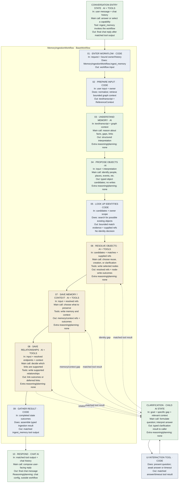
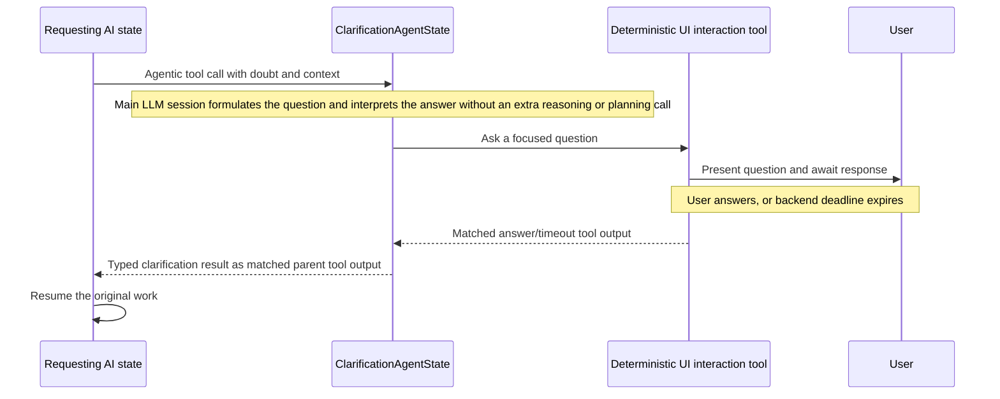

# Memory-ingestion workflow map

This is the single documentation home for the memory-ingestion flow diagram,
the functional input/output map, and each state’s reasoning/planning profile.
The [workflow base and handoff rules](deterministic-agentic-workflows.md) own
generic execution behavior. The local inspector reads the assembled workflow
configuration; a selected-run overlay can be added later.

## Sequence and handoffs

The current ingestion design is intentionally phased because later objects
depend on earlier resolved objects. Each box shows its input, action, output,
and LLM-call profile. “Extra reasoning/planning: none” means the state has
**no separately configured reasoning or planning call**; it still performs its
stated main LLM call. Code boxes make no LLM call.
Solid arrows are required workflow handoffs. Dashed arrows are optional
agentic-tool calls: only the state that identifies a material gap invokes
clarification, and its matched result returns to that same state before the
solid path advances.

Here, **AI state** means an LLM interprets information or chooses an action.
**Code** means a deterministic application step. The AI states in steps 6–8
call typed graph tools; those deterministic functions perform the actual writes.
The write states remain sequential because of reference dependencies. Within
one state, independent tool calls can run concurrently; its next LLM call waits
for the complete batch of matched outputs. This tool-level concurrency is not
another workflow state or a shortcut around the solid handoffs.
The table describes the functional handoff, not final DTO schemas.

`ConversationEntryState` is the agentic chat state. Its `ingest_memory` tool
invokes `MemoryIngestionWorkflow`; after that workflow returns one matched tool
output, the same chat state resumes and produces the user-facing response. At
framework level, an agentic state may invoke either another agentic state or a
workflow behind a registered tool. This internal handler type does not change
the parent tool-call protocol or make the child/workflow result a final chat
message.

| Step | Kind | Receives | Does | Produces | Reasoning/planning call profile |
| --- | --- | --- | --- | --- | --- |
| 1. Enter workflow | `ingest_memory` bound workflow method | Validated user input, owner, selected conversation/history context | Starts `MemoryIngestionWorkflow` from the chat-facing tool call | Input and owner context | No additional LLM call |
| 2. Prepare input | Deterministic code | User input and owner context | Normalizes text or obtains transcript; retrieves bounded existing context; builds owner projection and `ReferenceContext` | Text/transcript and relevant context | No LLM call |
| 3. Understand memory | `IngestionReasoningState` | Text/transcript and context | Interprets facts, ambiguities, likely connections, and what should remain episodic | Structured interpretation | Its main call is the ingestion reasoning; no separate reasoning or planning call is specified |
| 4. Propose objects | `NodeCandidateState` | Input, interpretation, supplied references | Generates typed object candidates | Candidate objects; no writes | Main call generates candidates; no separate reasoning or planning call is specified |
| 5. Look up identities | Deterministic service | Candidate identity details and owner scope | Searches for possible existing matches without deciding identity | Bounded match evidence and supplied existing-object references | No LLM call |
| 6. Resolve objects | `NodeResolutionWriteState` with deterministic tools | Candidates, match evidence, input, supplied references | Decides reuse versus creation; calls typed graph tools; may invoke the clarification child state if configured and needed | Resolved references and node-write outcomes | Main call resolves identities and uses tools; no separate reasoning or planning call is specified |
| 7. Save memory/context | `MemoryContextWriteState` with deterministic tools | Input and resolved target references | Decides what memory/context to preserve and calls typed write tools | Memory/context outcomes and references | Main call determines and requests writes; no separate reasoning or planning call is specified |
| 8. Save relationships | `RelationshipWriteState` with deterministic tools | Input, resolved endpoints, relevant memory/context outcomes | Decides which durable links are supported and calls typed write tools | Relationship outcomes or explicitly deferred links | Main call evaluates and requests links; no separate reasoning or planning call is specified |
| 9. Gather result | Deterministic workflow | Compact results from prior steps | Assembles one outcome for the caller | Typed ingestion result, returned as the matched `ingest_memory` tool output | No LLM call |
| 10. Respond | `ConversationEntryState` | Matched tool output and its own conversation context | Resumes its provider session and generates the user-facing reply | Final chat message | Determined by that state's configuration, outside this workflow |

## Functional behavior at each handoff

Input preparation is deterministic: it normalizes the input, retrieves and
hydrates bounded graph context, builds `ReferenceContext`, and adds the active
owner projection when relevant. It does not decide what the input means.
This flow does not require persisting the original chat message or a separate
source record; input text or a transcript is sufficient context for these steps.

`IngestionReasoningState` produces a structured, non-executable interpretation.
It may identify salient entities, aliases, ambiguities, likely durable
relationships, and details that should remain episodic rather than becoming
durable graph objects. It does not allocate persisted IDs or write to the graph.

`NodeCandidateState` identifies structured candidate objects from that
interpretation. It does not form graph queries, choose matching policy, or
write to the graph. The workflow then invokes deterministic identity lookup for
each candidate whose kind has configured lookup. The service derives its own
request, returns bounded candidate evidence, and adds supplied existing-object
references to `ReferenceContext`.

`NodeResolutionWriteState` receives each candidate with its lookup evidence.
It may select an explicitly supplied existing reference, create a new object,
or ask for clarification. Lookup evidence alone does not bind or merge an
identity, reject a candidate, or decide that clarification is required. Its
completed results make newly created or resolved references available to
dependent states.

`MemoryContextWriteState` precedes relationship work when a relationship needs
a context or perception object as an endpoint. `RelationshipWriteState` uses
references from completed prior results, not unresolved natural-language names.
Neither state invents a missing endpoint to satisfy a planned link.

The conditional clarification branch uses another AI state:

| Branch | Kind | Receives | Does | Produces | Reasoning/planning call profile |
| --- | --- | --- | --- | --- | --- |
| Clarify a material doubt | `ClarificationAgentState`, invoked by an agentic tool from the requesting state | Goal, specific doubt, relevant context, and `clarification_ref` | Its LLM session decides a useful question, calls the deterministic UI interaction tool, waits for an answer or timeout, and interprets the result | Typed clarification result returned as one matched tool output to the requesting state | Its main session handles questioning and answer interpretation; no separate reasoning or planning call is currently specified |

The first AI state is an application-specific reasoning state. Its main call
produces the interpretation used by later states. The framework also supports
optional reasoning and planning calls *inside* a state; the current ingestion
state specifications do not assign those additional calls. If a state later
needs one, its own specification must define the purpose and artifact. See
[configurable reasoning and planning](../ai-engineering/runtime/agentic-state-reasoning-and-planning.md).

Clarification is an agentic child state, available through a registered agentic
tool when the requesting state has that capability configured. The child owns
the question and its own LLM session. Its UI interaction tool is deterministic:
it presents the question and waits for the user's answer or the configured
timeout. The child then returns its typed result as the original parent tool
call's output, and that same requesting state continues before the workflow
advances.

This order is a dependency contract. The workflow merges valid reference
updates before preparing each dependent state. In particular, memory/context
and relationships use already resolved objects; lookup evidence alone never
binds an identity.

The order never requires fabricating a missing object or making a semantic
decision without the LLM. A state uses its configured tools within the provider
continuation protocol.

## Identity lookup and additive updates

Identity lookup is a deterministic backend capability within the workflow. It
owns normalization, allowed object kinds, bounded search, candidate
classification, graph access, redaction, and model-safe candidate packet
construction. The LLM receives the resulting packet as evidence only; it never
produces Cypher, persisted IDs, or an executable graph search.

When a supplied existing reference is selected, the normal default is additive:
the workflow may create a memory, supported relationship, claim,
perception, or context record against that reference. It must not silently
overwrite identity properties merely because a lookup found a plausible match.
An explicit, typed property-update contract is required for any direct update.

The same principle applies after clarification. A user answer enriches the
resumed state context; the agent must return the corrected value in its typed
result or tool arguments. Backend code never extracts a graph field from the
answer prose or explanation field.

## Related documentation

- [Deterministic agentic workflows](deterministic-agentic-workflows.md)
- [Ingestion application states](../ai-engineering/application-states/ingestion/README.md)
- [Ingestion flow](../flows/ingestion.md)
- [Clarification agent and UX](../requirements/functional/clarification-agent-and-ux.md)
